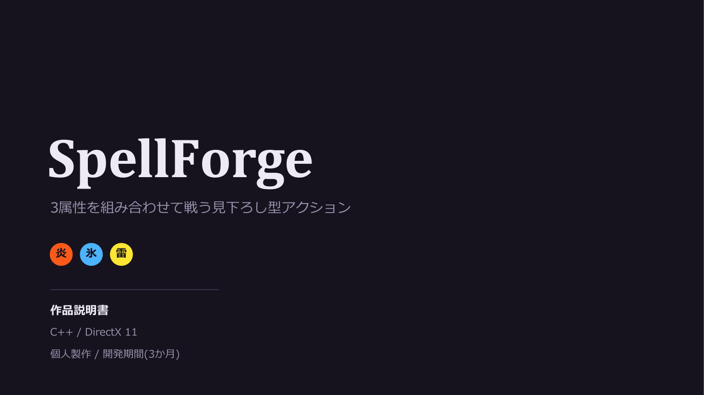
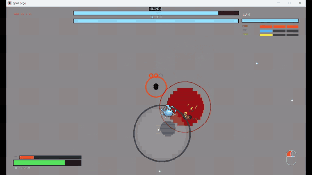
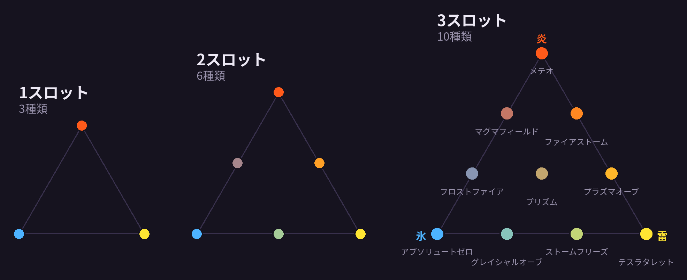
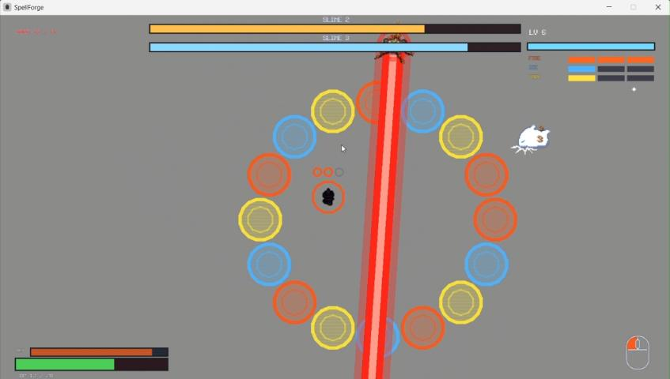
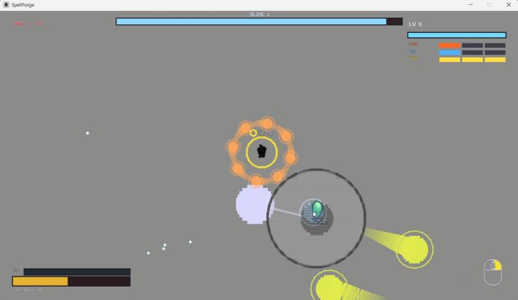

<div align="center">




**炎・氷・雷の3属性を組み合わせて戦う、見下ろし型アクションゲーム**

ゲームエンジンを使わず、C++20とDirect3D 11で一から制作しました。


📄 **[作品説明書（PDF）](docs/SpellForge_slides.pdf)**

</div>

---

## 概要

| 項目 | 内容 |
|---|---|
| ジャンル | 見下ろし型サバイバルアクション |
| 制作形態 | 個人制作（専門学校の課題） |
| 開発期間 | 約3か月 |
| 使用技術 | C++20 / Direct3D 11 / HLSL / XAudio2 / Win32 API |
| 開発環境 | Visual Studio 2026 |

炎・氷・雷の3属性を操る魔法使いを操作し、敵を倒して経験値を集めながらレベルアップしていきます。
全11ウェーブを勝ち抜き、最後のボスを倒すとクリアです。

攻撃は自動では出ません。属性を溜めて自分で発動するため、**位置取りと溜める組み合わせの判断**が生き残る鍵になります。

## ゲームの特徴

### 19種類の技 ― 溜めた属性の組み合わせで技が決まる

スロットに属性を1〜3個溜めて発動します。組み合わせは重複も抜けもなく、全部で19種類です。



- **炎**：高いダメージと火傷
- **氷**：減速と貫通
- **雷**：連鎖と召喚

### 6種類のビルド

属性強化はゲーム中に2回選べます。どの属性に振るかで、同じ技でも強さと戦い方が変わります。

| ビルド | 戦い方 |
|---|---|
| 炎特化 | 火力で押し切る |
| 氷特化 | 足止めと貫通で安全に立ち回る |
| 雷特化 | 連鎖と召喚で敵を処理する |
| 炎 / 氷 | 火力と足止めを両立する万能型 |
| 炎 / 雷 | 燃焼・連鎖・召喚で範囲を制圧する |
| 氷 / 雷 | 減速させながら連鎖と召喚で削り切る |

### 3種類のボス

最終ウェーブでは2体のボスが交互に必殺技を使い、プレイヤーに常に動き続けることを求めます。

| | |
|---|---|
|  |  |
| **通常ボス**：跳躍し、着地時に周囲へ衝撃 | **レーザーボス**：溜めの後にビームを放ち、追尾して薙ぎ払う<br>**壁ボス**：属性の壁で囲み、対応する属性でしか壊せない |

## 技術的なポイント

### 大量の敵を処理する仕組み
- **空間グリッド**（`spatial_grid.cpp`）：敵同士の押し合いと、技のダメージ判定の両方に使用しています。総当たりを避け、最大300体の敵を同時に処理します。
- **BFSフローフィールド**（`flow_field.cpp`）：プレイヤー位置から幅優先探索で方向場を作ります。すべての敵は経路を個別に計算せず、方向場を参照して移動します。
- **スプライトのバッチ描画**（`sprite.cpp`）：最大4096枚の矩形を1つの動的頂点バッファにまとめ、描画呼び出しの回数を抑えています。

### データ駆動の技設計
- 19種の技は、すべて`SkillDef`テーブル（`game_skill.cpp`）の1行として定義しています。ダメージ、見た目、効果音などの技に関する情報をここに集約しているため、技の追加や調整は主にデータの変更で済みます。

### ボスの行動制御
- 接近 → 予兆 → 跳躍 → 着地 → 必殺技、という状態遷移でボスの行動を制御しています（`game_boss.cpp`）。
- 攻撃の前に予兆の状態を挟み、プレイヤーが見て避けられるようにしています。
- 2体のボスが同時に出る場面では、必殺技を交互に使わせて、攻撃が重なりすぎないように調整しています。

### その他
- XAudio2による効果音のボイスプール管理と、技ごとのピッチ変化
- ビーム、冷気、軌跡などのエフェクト描画
- タイトル → ゲーム → リザルトのシーン遷移とフェード

## 操作方法

| 操作 | キー |
|---|---|
| 移動 | `W` `A` `S` `D` |
| 狙う方向 | マウスカーソル |
| 炎を溜める | マウス左ボタン長押し |
| 氷を溜める | マウスホイール押し込み |
| 雷を溜める | マウス右ボタン長押し |
| 技を発動 | `Space` |
| ポーズ | `P` |
| レベルアップ時の選択 | `A` / `D`（`←` / `→`）、`1`〜`3`、`Enter`、クリック |

## ビルド方法

1. **Visual Studio 2026**（「C++によるデスクトップ開発」ワークロード）をインストールします。
2. `Game/Game.slnx` を開きます。
3. 構成を `Release` / `x64` にして実行（`Ctrl + F5`）します。

※ Windows専用です。

## フォルダ構成

```
Game/
├── main.cpp / application.cpp   エントリポイント、メインループ
├── scene.cpp                    シーン管理（タイトル / ゲーム / リザルト）
├── direct3d.cpp / shader.cpp    Direct3D 11の初期化、シェーダー
├── sprite.cpp                   スプライトのバッチ描画
├── game_player.cpp              プレイヤー
├── player_charge.cpp            属性チャージ
├── game_skill.cpp               19種の技（SkillDefテーブル）
├── game_enemy.cpp               通常の敵
├── game_boss.cpp / boss_wall.cpp ボスの行動制御、属性の壁
├── enemy_spawner.cpp            ウェーブ管理
├── spatial_grid.cpp             空間グリッド
├── flow_field.cpp               BFSフローフィールド
├── Audio.cpp / game_audio.cpp   XAudio2サウンド
└── assets/                      テクスチャ、サウンド、コンパイル済みシェーダー
```

## 使用ライブラリ

- WICTextureLoader（Microsoft DirectXTK）：テクスチャ読み込み

---

制作：Chin Qing You（陳慶祐）
